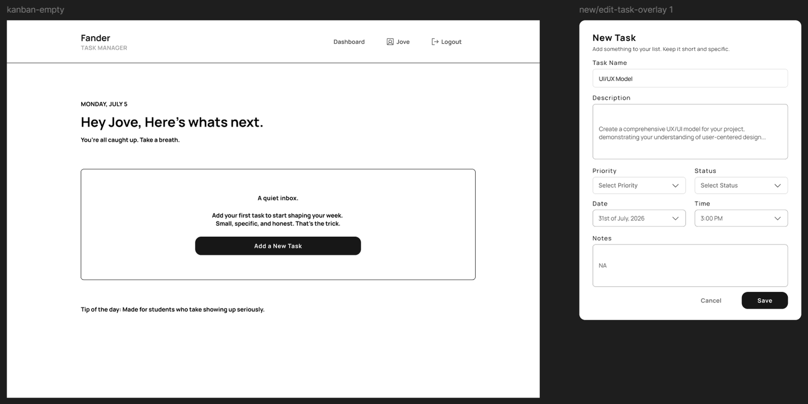
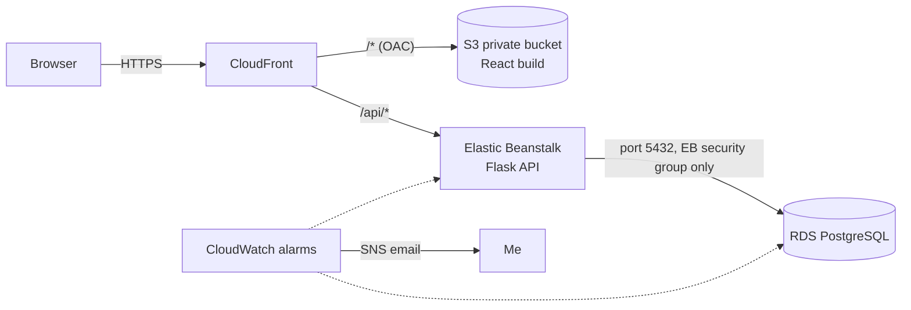
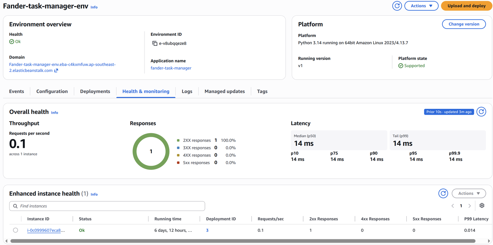
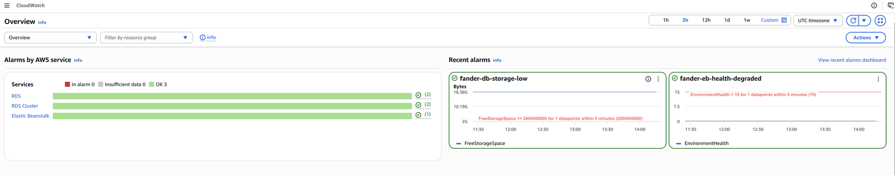
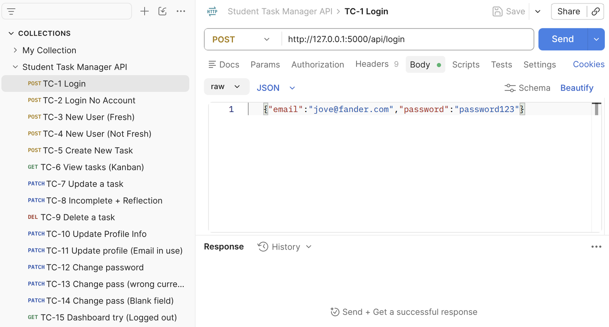

# Student Task Manager

A full-stack task manager that helps students track assignments, deadlines and progress on a Kanban board, deployed to AWS using RDS, Elastic Beanstalk, S3, CloudFront and CloudWatch.

Built as my individual project for **SD204B Cloud Application Development** (Diploma in Software Development, Year 2, Yoobee College NZ) for a fictional client, Fander University.

> **Status:** Deployed to AWS for the assessment (September 2026). The AWS environment has since been shut down, so there is no live demo. Screenshots of the deployment are below, and you can run it locally in a few minutes.



## Why it's different

Most task managers just let a task go overdue. This one asks the student to reflect instead: marking a task **Incomplete** requires a short note on what got in the way and what they'll do differently next time. Usability testers described this as "supportive" rather than nagging.

## Features

- Register, log in and log out (session-based auth with hashed passwords)
- Create, edit and delete tasks with title, description, due date, priority and notes
- Drag-and-drop Kanban board: **To do → In Progress → Complete / Incomplete**
- Required reflection note when a task is marked Incomplete
- Update name, email and password (current password required)
- Each student can only see and change their own tasks, enforced on the server
- Responsive layout for mobile, tablet and desktop

## Tech stack

| Layer | Technology |
|---|---|
| Frontend | React, TypeScript, Vite, Tailwind CSS, @dnd-kit |
| Backend | Python, Flask (REST API), Flask-Login, SQLAlchemy, Alembic |
| Database | PostgreSQL |
| Cloud | AWS RDS, Elastic Beanstalk, S3, CloudFront, CloudWatch + SNS |
| Design and testing | Frame0 (lo-fi), Figma (hi-fi and prototype), Microsoft Forms (usability test), Postman (API tests) |
| Project management | GitHub Projects |

## Architecture



CloudFront is the single entry point. Static files come from a private S3 bucket, and `/api/*` requests are routed to the Flask backend. Serving both from one domain solved a cross-site cookie problem (see below).

## AWS deployment

Region: `ap-southeast-2` (Sydney).

| Service | What it does | Key settings |
|---|---|---|
| **RDS (PostgreSQL)** | Stores users and tasks | db.t3.micro, 20 GiB, **no public access**, only reachable from the Elastic Beanstalk security group |
| **Elastic Beanstalk** | Runs the Flask API with Gunicorn | Python on Amazon Linux 2023, single instance (no load balancer, to keep costs down) |
| **S3** | Hosts the built React app | Public access fully blocked; only CloudFront can read it via Origin Access Control |
| **CloudFront** | HTTPS, caching and routing | HTTP → HTTPS redirect; `/api/*` uncached and forwards cookies; 403/404 → `index.html` for client-side routes |
| **CloudWatch + SNS** | Monitoring and email alerts | Alarms for RDS CPU > 80%, RDS free storage < 2 GB, and Elastic Beanstalk health degraded |

Secrets (`DATABASE_URL`, `SECRET_KEY`) were set as Elastic Beanstalk environment properties, never committed. Moving them to AWS Secrets Manager was considered but skipped to avoid extra cost for an academic project.

**Cost:** The estimate was about USD $34/month, and the actual bill for the deployment period was **$0.00** on the AWS Free Plan. See [docs/aws-cost.md](docs/aws-cost.md).

| Elastic Beanstalk health | CloudWatch alarms |
|---|---|
|  |  |

More deployment screenshots: [RDS](docs/screenshots/aws-rds-summary.png) · [S3 private bucket](docs/screenshots/aws-s3-private-bucket.png) · [CloudFront behaviors](docs/screenshots/aws-cloudfront-behaviors.png) · [Billing at $0](docs/screenshots/aws-cost-zero.png)

## Problems I solved

- **Login worked, but the session cookie never came back.** Locally, the frontend ran on `localhost` and the backend on `127.0.0.1`. The browser treated them as different sites, so it didn't send the `SameSite=Lax` cookie. I fixed it by using the same hostname for both. In production, I put the frontend and API behind one CloudFront domain for the same reason.
- **Requests going to `/api/api/...`.** The API client already adds `/api`, and setting `VITE_API_URL=/api` added it twice. I fixed it by leaving `VITE_API_URL` empty in production.
- **Refreshing `/dashboard` gave a blank page.** With Origin Access Control, S3 returns **403** (not 404) for unknown paths, so CloudFront's error handling didn't catch it. I mapped both 403 and 404 to `/index.html` with a 200 status so React Router can handle the route.
- **A CloudWatch alarm fired straight away.** I had set the storage alarm to "greater than 2 GB" instead of "less than". It was a good reminder to check an alarm's settings, not just create it.

## Testing

- **Usability test:** 4 participants tested the Figma prototype and rated each flow 4.25–5.0 out of 5. I carried two fixes into the build: auto-closing the edit modal on save, and stronger colour differences between statuses.
- **API and UI tests:** I wrote 15 black-box test cases in Postman, covering login, registration, task CRUD, status changes, the reflection rule, account updates and logout. They all passed against both the API and the UI. See [docs/uat-criteria.md](docs/uat-criteria.md).



## Running it locally

**You'll need:** Python 3.11+, Node.js 18+ and a local PostgreSQL database.

**Backend**
```bash
cd backend
python -m venv venv
venv\Scripts\activate          # Windows  (macOS/Linux: source venv/bin/activate)
pip install -r requirements.txt
cp .env.example .env           # then set DATABASE_URL and SECRET_KEY
flask db upgrade               # creates the tables
flask run                      # http://localhost:5000
```

**Frontend** (in a new terminal)
```bash
cd frontend
npm install
npm run dev                    # http://localhost:5173
```

## Project structure

```
student-task-manager/
├── backend/
│   ├── app.py              # Flask app factory, CORS, blueprints
│   ├── config.py           # reads settings from environment variables
│   ├── models/             # User and Task (SQLAlchemy)
│   ├── routes/             # auth.py, tasks.py (REST endpoints)
│   ├── migrations/         # Alembic database migrations
│   ├── wsgi.py, Procfile   # Gunicorn entry point for Elastic Beanstalk
│   └── requirements.txt
├── frontend/
│   └── src/
│       ├── api/            # API client and mock data layer
│       ├── components/     # KanbanBoard, TaskCard, TaskForm, ReflectionModal...
│       ├── context/        # AuthContext
│       ├── pages/          # Login, Register, Dashboard, AccountSettings
│       └── types/
└── docs/                   # plan, requirements, API, costs, diagrams, wireframes
```

## Documentation

- [Project plan](docs/project-plan.md)
- [Software requirements specification](docs/SRS.md)
- [User acceptance test criteria](docs/uat-criteria.md)
- [API endpoints](docs/api-endpoints.md)
- [AWS cost estimate vs actual](docs/aws-cost.md)
- Diagrams: [use case](docs/diagrams/use-case-diagram.drawio.png) · [class](docs/diagrams/class-diagram.drawio.png) · [activity](docs/diagrams/activity-diagram.png) · [database model](docs/diagrams/database-model.png)
- Wireframes: [lo-fi 1](docs/wireframes/lofi-v1-01.png) · [lo-fi 2](docs/wireframes/lofi-v1-02.png) · [hi-fi](docs/wireframes/hifi-v1.png) · [login and account screens](docs/screenshots/design-auth-account.png)

## What I'd do next

- Add automated backend tests with pytest (the API was tested manually in Postman)
- Validate status, priority and date values on the server and return clear 400 errors
- Move secrets to AWS Secrets Manager and set up a custom domain with ACM
- Add task reminders, which were out of scope for this version

## Author

**Jove Tondo**, Diploma in Software Development, Yoobee College, Tauranga NZ
[GitHub](https://github.com/Owshuhnee) · [LinkedIn](https://www.linkedin.com/in/jove-tondo-190941356)
