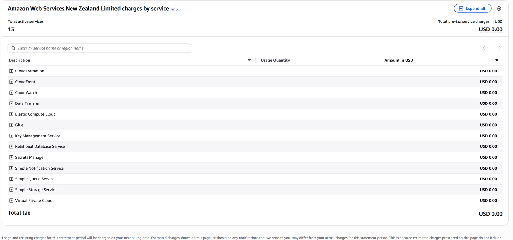

# AWS Cost: Estimate vs Actual

## Estimate (AWS Pricing Calculator, during planning)

| Service | Monthly (USD) |
|---|---|
| Amazon RDS for PostgreSQL | 23.20 |
| Amazon EC2 (Elastic Beanstalk instance) | 9.64 |
| Amazon CloudFront | 1.50 |
| Amazon S3 | 0.03 |
| **Total** | **34.37 / month (412.44 over 12 months)** |

RDS is the largest cost by far. That's why the database used the smallest instance class (db.t3.micro) and single-AZ, and why Elastic Beanstalk ran as a single instance with no load balancer.

## Actual (deployment period, September 2026)

**USD $0.00** across all 13 active services, as shown in the AWS Bills console. The account ran on the AWS Free Plan with promotional credits.

## Cost decisions

- **No Multi-AZ on RDS.** It would roughly double the database cost. Automated backups (1-day retention) still allow point-in-time recovery.
- **No load balancer or auto scaling.** This isn't needed at student-project traffic levels, and Elastic Beanstalk can add it later without code changes.
- **No AWS WAF or Secrets Manager.** Both add monthly charges, and they were noted as production improvements instead.
- **The environment was shut down after assessment,** so it doesn't build up charges.
